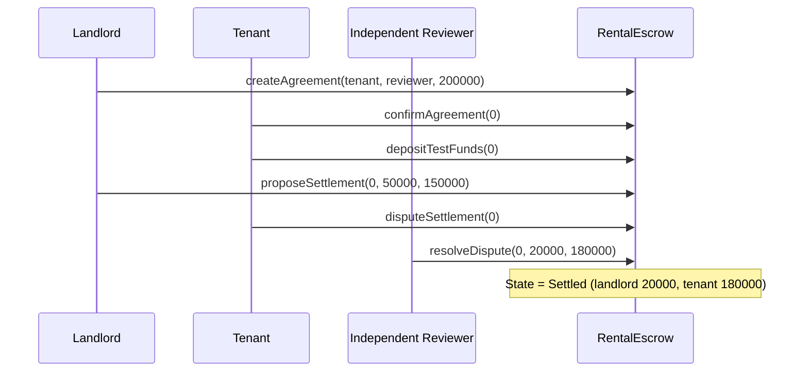

Educational project for the course Introduction to Finance. Not a real product, service or investment offer. Do not use with real funds.

# RentProp Prototype

**Team 4, Astana IT University:** Seitkali Korkem, Maratova Dana, Bolatuly Assylzhan (SE-2533)
**Course:** Introduction to Finance – Final Project
**Demo video:** [Team04_FP_Demo.mp4 (university OneDrive)](https://astanait-my.sharepoint.com/:v:/r/personal/254062_astanait_edu_kz/_layouts/15/stream.aspx?id=%2Fpersonal%2F254062_astanait_edu_kz%2FDocuments%2FRentProp%20Final%20Project%2FTeam04_FP_Demo.mp4&nav=eyJyZWZlcnJhbEluZm8iOnsicmVmZXJyYWxBcHAiOiJPbmVEcml2ZUZvckJ1c2luZXNzIiwicmVmZXJyYWxBcHBQbGF0Zm9ybSI6IldlYiIsInJlZmVycmFsTW9kZSI6InZpZXciLCJyZWZlcnJhbFZpZXciOiJNeUZpbGVzTGlua0NvcHkifX0&share=cQqM4AIJWzzATbsxv-TInFxlEgUCFutjHBWNPG5vX4GB6DVoOw)
**Network:** local Hardhat network only. No public testnet is used, so there is no testnet contract address.

## What the prototype does

RentProp is a hypothetical platform for settling security deposits in long-term residential rentals. This repository contains its core smart contract, `RentalEscrow.sol`. The contract:

- records a rental agreement between a **landlord**, a **tenant** and an **independent reviewer**;
- moves each agreement through fixed states: `Created → Confirmed → Funded → Proposed → (Disputed) → Settled`;
- lets the deposit be split only in two ways: by the landlord's proposal plus the tenant's approval, or by the reviewer's decision after a dispute;
- checks that the landlord and tenant amounts always add up exactly to the deposit;
- emits an event at every step, which gives a full audit trail.

The contract **does not hold or transfer any money, Ether or tokens**. Values such as `200000` are fictional test units stored as data. In a real product, a licensed custody partner would hold the deposit.

### Roles and functions

| Function | Who can call it | Required state | New state |
|---|---|---|---|
| `createAgreement(tenant, reviewer, deposit)` | Landlord (caller) | – | Created |
| `confirmAgreement(id)` | Tenant | Created | Confirmed |
| `depositTestFunds(id)` | Tenant | Confirmed | Funded |
| `proposeSettlement(id, landlordAmount, tenantAmount)` | Landlord | Funded | Proposed |
| `approveSettlement(id)` | Tenant | Proposed | Settled |
| `disputeSettlement(id)` | Tenant | Proposed | Disputed |
| `resolveDispute(id, landlordAmount, tenantAmount)` | Independent reviewer | Disputed | Settled |

Access rights are enforced by the `onlyLandlord`, `onlyTenant` and `onlyReviewer` modifiers, together with an `agreementExists` check.

### Main use case (disputed settlement)



A PNG version is in `docs/RentProp_Sequence_Diagram.png`.

## Repository structure

```
contracts/RentalEscrow.sol   smart contract
test/RentalEscrow.ts         11 unit tests (Mocha + Chai)
scripts/demo.ts              runs the main use case step by step
scripts/gas.ts               measures gas per function and per agreement
scripts/model.mjs            financial model check: NPV, payback, terminal value, fee sensitivity, gas economics
docs/                        sequence diagram
SECURITY.md                  threats and mitigations
```

## How to run it

Requirements: Node.js 22 or later and npm.

```bash
npm install                                  # install Hardhat and the test tools
npx hardhat compile                          # compile the contract
npx hardhat test                             # run all 11 unit tests on the local network
npx hardhat run scripts/demo.ts              # run the main use case
npx hardhat run scripts/gas.ts               # measure gas per transaction
node scripts/model.mjs                       # recompute the financial tables of the report
```

All commands run on Hardhat's built-in local network with test accounts created by the tool. No `.env` file, private key or wallet is needed. On Windows PowerShell, use `npx.cmd` instead of `npx` if script execution is blocked.

## Tests

The prototype has **11 unit tests, and all 11 pass**:

```
RentalEscrow
  ✔ creates a rental agreement
  ✔ allows only the tenant to confirm the agreement
  ✔ does not allow test deposit before confirmation
  ✔ allows only the landlord to propose a settlement
  ✔ requires settlement allocation to equal the deposit
  ✔ allows the tenant to approve a valid settlement
  ✔ allows only the reviewer to resolve a dispute
  ✔ does not allow the same agreement to be settled twice
  ✔ rejects a settlement below the deposit
  ✔ allows only the tenant to approve or dispute a proposal
  ✔ allows only the tenant to record the test deposit

11 passing
```

| # | Test | Control verified |
|---|---|---|
| 1 | Creates a rental agreement | Participants, deposit amount and agreement ID are stored |
| 2 | Only tenant can confirm | Another account cannot confirm the agreement |
| 3 | No deposit before confirmation | The Funded state cannot be reached before confirmation |
| 4 | Only landlord can propose | The tenant cannot submit a settlement proposal |
| 5 | Allocation must equal deposit | An allocation above the deposit is rejected |
| 6 | Tenant can approve | The no-dispute path reaches Settled with the proposed amounts |
| 7 | Only reviewer can resolve | Another account cannot resolve the dispute |
| 8 | Cannot settle twice | A second resolution after Settled is rejected |
| 9 | Rejects allocation below deposit | An allocation below the deposit is rejected |
| 10 | Only tenant can approve or dispute | Another account cannot approve or dispute a proposal |
| 11 | Only tenant can record the deposit | Another account cannot record the test deposit |

Each test deploys a new contract in `beforeEach`, so the tests do not depend on each other. Rejected calls are checked with `revertedWith`, which also confirms the reason for the error, for example `"Only tenant"` or `"Allocation must equal deposit"`.

## Gas measurement

Output of `scripts/gas.ts` on the local network:

| Case | Transactions | Total gas |
|---|---|---|
| Agreed settlement | 5 | 342,462 |
| Disputed settlement | 6 | 381,862 |
| Average at 5% disputes | 5.05 | 344,432 |

The report uses this figure to show that public-network gas fees would take about 57% of the KZT 18,000 service fee. This is why the commercial design uses a permissioned network with a gas price of zero.

## Security controls

- Role-based access control for every state-changing function
- Fixed order of state transitions
- Allocation rule: landlord amount + tenant amount = deposit
- Protection against double settlement
- No external value transfers, so reentrancy does not apply to the current version

See `SECURITY.md` and Section 2.5 of the report for the full threat analysis and the planned external audit.

## Safety

All accounts and balances are fictional and exist only on the local Hardhat network. The project uses no real funds, cryptocurrency, personal data, seed phrases or private keys. `.env` files are listed in `.gitignore`. The contract must never be deployed to a main network or connected to real funds.

## Tools and AI disclosure

Built with Solidity 0.8.34, Hardhat 3, TypeScript, Ethers.js v6, Mocha and Chai. No OpenZeppelin code is used. ChatGPT (GPT-5.6 Sol Pro) helped with routine Solidity and TypeScript code and drafts of the tests. Claude (Claude Opus 5.5) helped draft this README. The team reviewed, ran and tested all of the code.

## License

MIT (see the SPDX header in `contracts/RentalEscrow.sol`).
