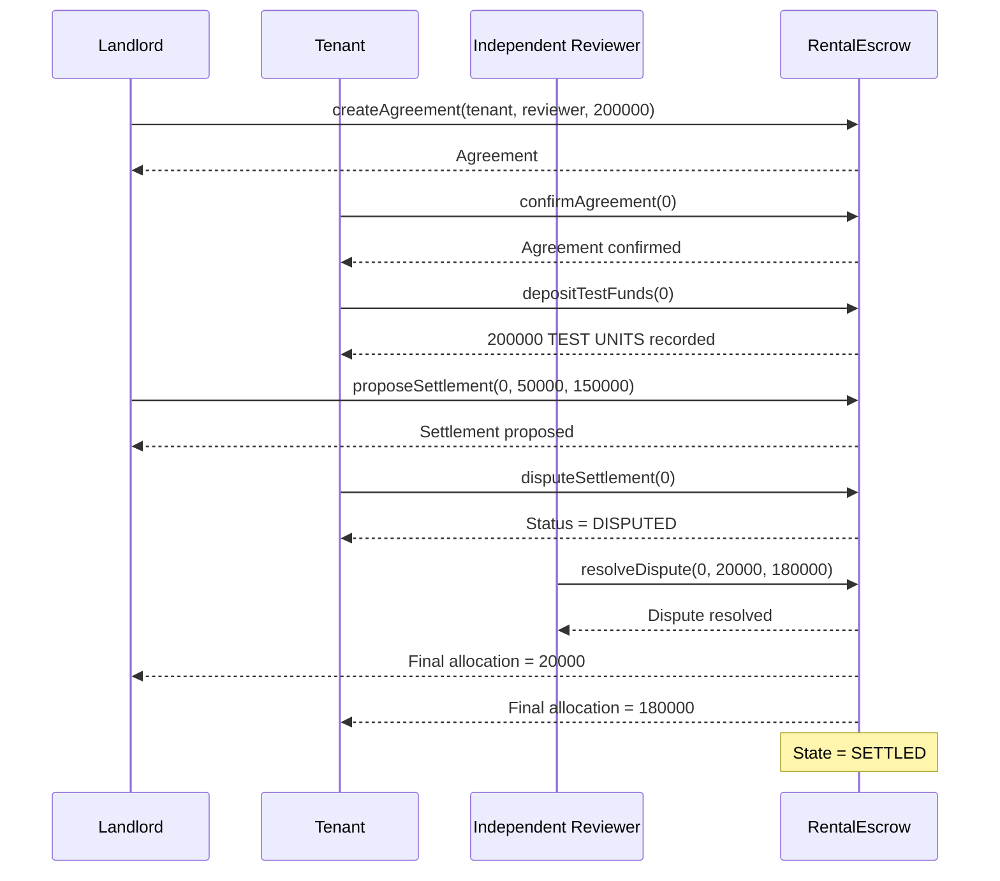

Educational project for the course Introduction to Finance. Not a real product, service or investment offer. Do not use with real funds.

# RentProp Prototype

## Overview

RentProp is an educational prototype for managing security deposit settlements in long-term residential rentals.

The prototype uses fictional test accounts and balances only. No real money, cryptocurrency, personal customer data, or production wallets are used.

## Main Participants

- Landlord
- Tenant
- Independent Reviewer

## Main Flow

1. The landlord creates a rental agreement.
2. The tenant confirms the agreement.
3. The tenant records a fictional test deposit.
4. The landlord proposes a settlement.
5. The tenant can approve or dispute the proposal.
6. If disputed, the independent reviewer determines the final allocation.
7. The agreement becomes settled.

## Sequence Diagram

The following diagram shows the main dispute-settlement flow implemented in the RentProp prototype.



> Educational prototype running on a local Hardhat development network. All balances are fictional test units.

## Technology

- Solidity
- Hardhat
- TypeScript
- Ethers.js
- Mocha
- Chai

## Run the Prototype

Compile the smart contract:

```bash
npx hardhat compile
```

Run the main RentProp demo:

```bash
npx hardhat run scripts/demo.ts
```

Run the unit tests:

```bash
npx hardhat test test/RentalEscrow.ts
```

## Tests

The prototype includes 8 unit tests covering:

- Agreement creation
- Tenant-only agreement confirmation
- Deposit state validation
- Landlord-only settlement proposal
- Settlement allocation validation
- Tenant approval
- Reviewer-only dispute resolution
- Double-settlement prevention

## Security Controls

The prototype demonstrates:

- Role-based access control
- Controlled agreement state transitions
- Deposit allocation validation
- Protection against double settlement
- Separation of participant roles

## Safety

All accounts and balances are fictional and run only on a local Hardhat development network.

No real funds, cryptocurrency, private customer information, seed phrases, or production private keys are used.

## Demo Video

[Watch the RentProp Prototype Demo](https://astanait-my.sharepoint.com/:v:/r/personal/254062_astanait_edu_kz/_layouts/15/stream.aspx?id=%2Fpersonal%2F254062_astanait_edu_kz%2FDocuments%2FRentProp%20Final%20Project%2FTeam04_FP_Demo.mp4&nav=eyJyZWZlcnJhbEluZm8iOnsicmVmZXJyYWxBcHAiOiJPbmVEcml2ZUZvckJ1c2luZXNzIiwicmVmZXJyYWxBcHBQbGF0Zm9ybSI6IldlYiIsInJlZmVycmFsTW9kZSI6InZpZXciLCJyZWZlcnJhbFZpZXciOiJNeUZpbGVzTGlua0NvcHkifX0&share=cQqM4AIJWzzATbsxv-TInFxlEgUCFutjHBWNPG5vX4GB6DVoOw)